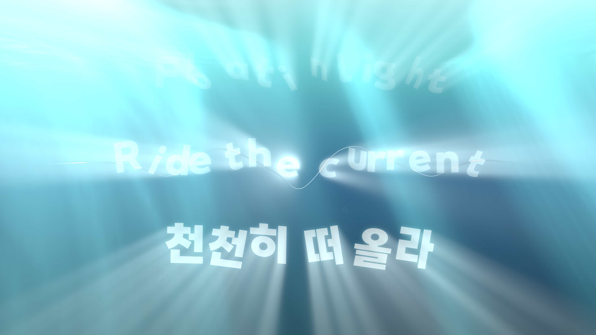
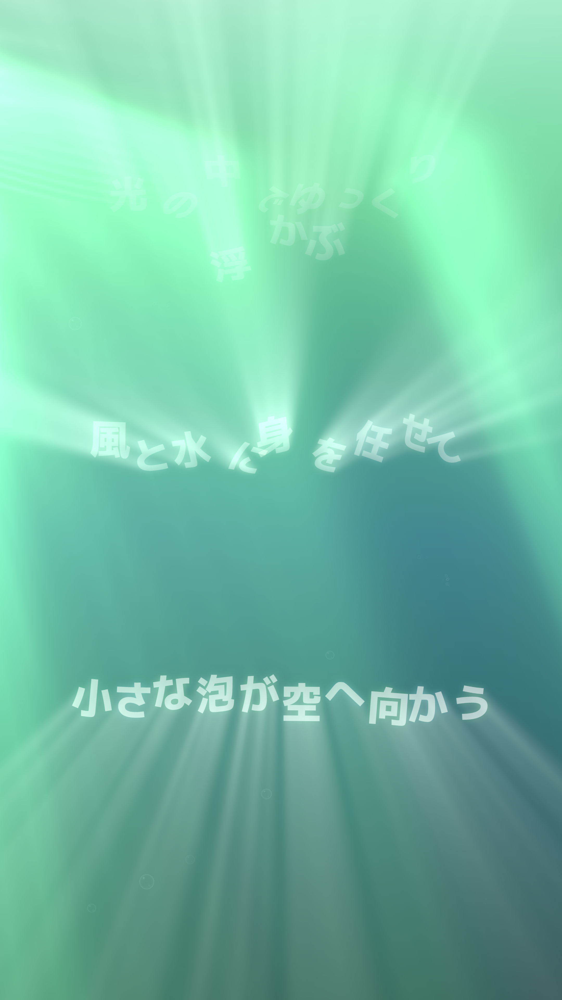

# Spotify Float

Turn your music into a little underwater stage. Lyrics appear, drift apart and float upward, while a live waveform follows the audio playing in Spotify.

**Windows 11 x64 · Spotify desktop + Spicetify · Single or dual monitors · WebGPU / optional HDR**



*A preview using demo phrases written for this project. This is an SDR screenshot of an HDR-capable renderer; a web image cannot reproduce the display's actual HDR brightness.*

[Download the latest release](https://github.com/moveout824/spotify-float/releases/latest) · [All features and technical details](docs/FEATURES.md) · [Troubleshooting](docs/TROUBLESHOOTING.md)

## Version 1.0.1

The current release uses smoother curve geometry with separate, fast music and kick envelopes. Quiet tracks remain visible, pause/resume settles naturally, and GPU backpressure limits the queue of old frames. The waveform stays curved throughout. See the [changelog](CHANGELOG.md).

### Updating an existing installation

1. Quit the old **Spotify Float helper from its tray menu**. Closing its visuals with Esc leaves the helper running.
2. Extract the new Windows ZIP into its own folder. Optionally copy your old `app/state/stage-config.json` into the new folder's `app/state/` to keep your local settings. Keep that private file on your computer.
3. Run `install.cmd` from the new folder. This reapplies the button and updates the background startup path.
4. Play Spotify locally and use Float beside Repeat. Keep the previous folder until the new copy works.

The four screenshots illustrate the ocean's visual style. Animation and audio response were refined in 1.0.1.

## Start here

1. Install and open the **Spotify desktop app** on Windows 11. Sign in and make sure a song plays on this computer.
2. Download the release **ZIP** from [Releases](https://github.com/moveout824/spotify-float/releases/latest). Choose the packaged app asset, rather than GitHub's automatically generated “Source code” ZIP.
3. Extract the **whole ZIP** into a folder. Keep the app, resources and helper files together.
4. Run **`install.cmd`** and follow its messages. The Spotify button uses Spicetify; if it is missing on your computer, follow the installer's instructions or the [official Spicetify setup guide](https://spicetify.app/docs/getting-started).
5. Reopen Spotify if the installer asks you to, start a song, then click the small **Float button beside Repeat** in the playback bar.

You do not need Node.js or Visual Studio to use a packaged release.

### Pick your screen layout

| What you want | Run | What opens |
| --- | --- | --- |
| Everything on one monitor | `Single-mode.cmd` | Floating lyrics behind the foreground waveform |
| Lyrics and waveform on separate monitors | `Dual-mode.cmd` | A lyrics screen and a waveform screen |
| Restore a missing Spotify button | `Repair-button.cmd` | Reapply the button integration |
| Restore background startup | `Repair-startup.cmd` | Register the current folder as the sign-in helper |

You can also change modes from the **Spotify Float tray icon**. A computer with one display automatically uses single-monitor mode. In dual mode, a portrait display is preferred for lyrics when one is available.

## What it feels like

### Floating lyrics you can play with

Lines rise slowly from below the screen and drift through the water. Individual characters gradually separate, sway and turn in three dimensions. Grab a letter, drag it around, or release it to throw it into nearby letters and bubbles.

The light follows the real projected letter shapes. It stays present while the visible letters become transparent, then fades with their lifetime. The crisp original letters are displayed once; the surrounding light is made from a diffused silhouette.



*Portrait preview with self-written demo phrases. SDR capture; the displayed font depends on the installed and bundled fonts.*

### A waveform that listens to Spotify

The native audio helper captures **Spotify and its child processes**, rather than the entire Windows sound mix. Notifications, another browser and other media players are outside that selected process tree.

The waveform is peak-normalized for readability. Fast causal music and bass envelopes drive its height and the white core's **1.5 to 5 CSS pixel** thickness. Its phase-aligned curve moves more gently, with critically damped geometry, so a sharp beat does not require the whole shape to jump. On silence, the shape stops changing and its height fades to the baseline. The native capture follows actual PCM rather than waiting for Spotify's slower play/pause metadata.

The waveform emits its own softer light. Its original white core receives a positive HDR lift where supported, and stays anchored to the audio geometry. There is **no dark shadow ribbon behind the waveform**.


*Waveform preview with demo content. SDR capture of the renderer, not an audio recording.*

### One shared ocean

The scene moves gently through **Blue → Emerald → Sunset**, with subtle artwork-based color variation and smooth song transitions. Water-surface reflections, caustics, bubbles and foreground light use the same palette.

Background light shafts move faster as the music's raw digital level increases, with smooth acceleration and deceleration. Their **position clock stops** when Spotify is paused, disconnected or genuinely silent. Water, color and brightness animation can continue; the whole scene does not freeze.

## Controls

| Action | Control |
| --- | --- |
| Open or close the stage | Float button in Spotify, or the tray menu |
| Close the visible stage | `Esc` |
| Play / pause Spotify | `Space` while the stage is focused |
| Show the controls | `H` |
| Show lyrics a little earlier | `→` or the `+` sync button, in 200 ms steps |
| Show lyrics a little later | `←` or the `−` sync button, in 200 ms steps |
| Seek within a song | Click the waveform / progress line |
| Move a letter | Drag it with the left mouse button |
| Throw a letter | Drag, then release |
| Stir the water | Move the pointer through the scene |

The initial lyric correction is **+300 ms**. In single-monitor mode the waveform is the front layer, so clicking its line seeks even when a floating letter is behind it.

## Requirements and realistic expectations

| Item | Support |
| --- | --- |
| Operating system | **Windows 11 x64** |
| Spotify | Desktop client that can be customized with Spicetify |
| Graphics | Hardware-accelerated Canvas / WebGPU for the full optical effects |
| HDR | Optional: compatible display, GPU/driver and **HDR enabled in Windows** |
| Display layout | One monitor, or two monitors for separate lyrics and audio views |
| Network | Needed for Spotify and for lyric lookup when an online source is used |

The Spotify-only capture API requires **Windows build 20348 or later**. This release targets Windows 11; ordinary consumer Windows 10 installations are not supported by its native capture path. See [Microsoft's process-loopback sample](https://learn.microsoft.com/en-us/samples/microsoft/windows-classic-samples/applicationloopbackaudio-sample/).

Synthetic renderer and native-envelope checks pass, including seven expected kicks in a 120 BPM test sequence. These tests do not measure the sound reaching a particular pair of headphones or speakers; live acoustic synchronization remains unverified.

The renderer uses a 4K output canvas and follows the display's refresh rate. Actual frame rate depends on your GPU, drivers, monitor layout and other workloads. **120 FPS is not guaranteed on every computer.** SDR displays can still use the app; actual HDR highlights appear only when the complete HDR path is available. [Enable or check HDR in Windows](https://support.microsoft.com/en-us/windows/hardware/display-graphics/hdr-settings-in-windows).

Spotify Float is an independent visualizer, not an official Spotify feature. The public package does not include an ad-blocking or ad-skipping engine.

## Lyrics and fonts

Lyrics come from Spotify when available, with **LRCLIB** as a fallback. Timed lyrics use their supplied timestamps. Plain lyrics use estimated timing and are identified as estimated. When no lyrics are available, the waveform and ocean still work. The app does not invent missing lyrics or translate their wording.

The public release uses **Noto Sans CJK KR Black** as its Korean/Latin fallback. Japanese text uses **M PLUS 1p 800**, with **Noto Sans CJK JP Black** fallback; Chinese text uses **Noto Sans CJK SC / TC Black**. Bundled fonts carry their own OFL notices.

**OA Gothic ExtraBold is optional and is not included in this repository or release ZIP.** If you want it, obtain your own copy from [the official OA font site](https://font.oa-world.com), follow its terms and install it in Windows. Restart Float afterward. The app can try a locally installed OA font through `CSS local()` and otherwise uses the bundled Noto fallback. Personal font files should stay local and out of public archives.

## Privacy and local operation

- The default native audio path uses a Spotify process-tree loopback. It does not capture the microphone or screen video.
- Waveform and spectrum data are processed locally. The app does not save or upload PCM audio recordings.
- The Spotify extension and desktop helper communicate through a local loopback bridge. A private bridge key is generated for each installation; it is not a Spotify password or a public API key.
- Spotify lyric requests use your existing client. LRCLIB fallback lookup sends song metadata such as title, artist, album and duration to LRCLIB.
- Settings and diagnostic logs are local. Do not publish your generated bridge settings, keys, private profiles or personal lyric captures in an issue.

## Need a hand?

Start with [Troubleshooting](docs/TROUBLESHOOTING.md). If Spotify updated and the button disappeared, `Repair-button.cmd` is the first thing to try.

For bug reports, include your Windows build, GPU, monitor arrangement, HDR status, app version and a short description of what happened. A screenshot with your own demo text is welcome. Please keep installation keys and audio files out of public reports.

Ideas and improvements are welcome in [Issues](https://github.com/moveout824/spotify-float/issues) or a pull request. The [feature guide](docs/FEATURES.md) explains the signal path, rendering and design choices for contributors.

## Build from source

Packaged-release users can skip this section. For development, use Windows x64 with Node.js/npm, an x64 MSVC C++ toolchain and a recent Windows SDK containing the process-loopback headers.

```powershell
git clone https://github.com/moveout824/spotify-float.git
cd spotify-float
npm install
npm run build:native
npm test
npm run package
```

`npm start` runs the Electron app in development. Spotify's button still needs the matching installed extension/bridge configuration. Quit an installed helper before running a separate development copy, so both do not compete for the local bridge. Keep generated installation keys and personal font files out of commits.

## Credits and license

Created and maintained by [moveout824](https://github.com/moveout824).

Spotify Float uses Electron and Spicetify, the Windows process-loopback API, and bundled Noto / M PLUS fonts. Its original renderer takes inspiration from published water and volumetric-lighting techniques; the small playback-bar icon is an image-generated raster asset. [Detailed credits and source references](docs/FEATURES.md#credits-and-source-references) are in the feature guide.

Original project code is provided under the [MIT License](LICENSE). Third-party fonts and components retain their own licenses. OA Gothic files, Spotify music and actual song-lyric screenshots are not distributed in the public repository.
